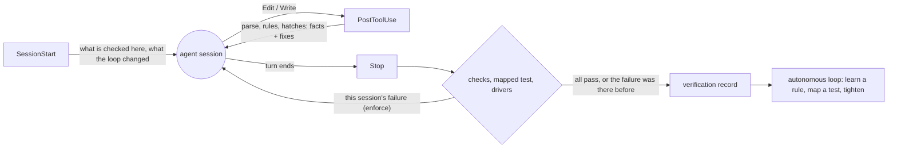

# Ratchet

[](https://github.com/kootru-repo/trust-ratchet/actions/workflows/ci.yml)
[](LICENSE)


**A trust harness for AI coding agents.** Ratchet runs programs around a coding agent: after every edit and before every turn ends. What the programs find goes back to the agent as facts, each with its fix. A correction you make once becomes a rule that is checked from then on, so the same mistake cannot come back quietly. Like a ratchet, it only tightens.

It works with [Claude Code](https://claude.com/claude-code) through its hooks. It has no runtime dependencies and uses no API key.

> **Built on Lauren Tan's lessons.** Ratchet puts into practice the principles of her talk ["All Code Is Slop (Except Mine)"](https://ai.engineer/code/2026/talks/lauren-tan) ([video](https://www.youtube.com/watch?v=ZZ19zhYnDKY)) and of her [pstack](https://github.com/cursor/plugins/tree/main/pstack) plugin: a program decides before a model does, every correction becomes a lint rule or a test, and the one who wrote the code never signs it off. If you have not seen the talk, start there. [What Ratchet takes from each](#inspired-by).

```
agent edits a file ──► programs check it ──► facts go back to the agent
agent ends its turn ─► checks, the mapped test, drivers ─► a failure the session caused holds the turn
you correct the agent ─► `ratchet rule add` ─► proven on the fix commit ─► checked on every edit from now on
```

## Contents

- [Why](#why)
- [Inspired by](#inspired-by)
- [What it does](#what-it-does)
- [See it in one minute](#see-it-in-one-minute)
- [Quick start](#quick-start)
- [How it works](#how-it-works)
- [Use cases](#use-cases)
- [Commands](#commands)
- [Configuration](#configuration)
- Guides: [CI for your project](docs/CI.md), [tests that catch more](docs/TESTING.md)
- [Code review](#code-review)
- [Experimental parts](#experimental-parts)
- [What it writes and how to remove it](#what-it-writes-and-how-to-remove-it)
- [FAQ](#faq)
- [Contributing](#contributing)

## Why

A coding agent says "done, tests pass" whether or not that is true. Asking it to be more careful adds another line of prose it may not follow. Ratchet takes the other route:

1. **A program decides before a model does.** Parse checks, rules, type checks and tests run first. Their results are facts.
2. **Every correction becomes a check.** A fix you had to ask for turns into a rule or a test, not another instruction.
3. **Nothing loosens by itself.** Backlogs may fall and never rise. The harness's own loop may add or tighten; every change is logged with its undo.
4. **The author is never the reviewer.** Review is done by sessions that never saw the work, and a finding stands only with quoted code a program has matched against the tree.

## Inspired by

Ratchet is an independent project. It shares no code or prompts with its sources and is not affiliated with or endorsed by their authors; the ideas are theirs, the mistakes are ours.

**Lauren Tan, ["All Code Is Slop (Except Mine)"](https://ai.engineer/code/2026/talks/lauren-tan)** (AI Engineer CODE 2026, [video](https://www.youtube.com/watch?v=ZZ19zhYnDKY)). The talk's lessons are the design:

| Lesson from the talk | In Ratchet |
|---|---|
| Each correction becomes a deterministic check, not a line of prose | `ratchet rule add`, proven on the fix commit it comes from |
| Agents copy what is there: stop new cases, then clean the old ones | A census of each rule's fault; the backlog may fall and never rise |
| Ban what needs nuance to use well; imports across a boundary are forbidden | `ban-api`, `ban-pattern` and `ban-import` rules on the files you name |
| Comments become excuses | The escape-hatch ceiling, and `ratchet comments --mode excuses` |
| A check's message names the root cause and the fix | A rule without its fix text is refused; every finding reaches the agent with its fix |
| Runtime verification: run the code | The mapped test and the drivers run before a turn may end; the reusable CI gate runs the project's lint, type-check and tests on every merge; `ratchet mutate` shows whether a test would catch a break, and the model-check helper runs every event sequence of a small state machine |
| Review the verification artifacts, not the diff | Every checked turn leaves a verification record |
| Judge by outcomes: reverts and the fixes that follow | `ratchet measure` reads fixes, fixes of a fix and reverts from git history |

`ratchet lessons` prints a card of all nineteen lessons of the talk for your project: which are in use, what effect is measured, and which Ratchet does not do (it says so for each).

**[pstack](https://github.com/cursor/plugins/tree/main/pstack)**, her plugin of working practice for coding agents. Ratchet's experimental swarm holds workers and verifiers to its rules: a verdict covers one patch, the verifier never wrote the code it proves, a fault the base already has does not block, and a worker stages only the files it changed.

**Sashiko**, the Linux kernel review system (Gushchin and Brewer, "Sashiko: Lessons from building an agentic code review system for Linux", Google Cloud blog, 2026). Ratchet's review takes from it: one focus per reviewer, every reviewer records what it ruled out, shaky dismissals get a second look, one verifier per hard case.

## What it does

| | |
|---|---|
| **After each edit** | Checks that the file parses, that it breaks none of the project's rules, and that no escape hatch was added (`as unknown as`, `@ts-ignore` and the like). |
| **Before the turn ends** | Runs the same checks on every file the session changed, then the project's own commands: checks, the one test mapped to those files, and drivers that run the real thing. Writes a verification record. |
| **Built-in checks** | `builtin:lf` fails a changed file git would store with carriage returns. `builtin:protected` fails any change to recorded references (fixtures, golden files, snapshots) until you allow a re-record with `ratchet allow-protected`. `builtin:generated` checks that committed build output still matches its sources, building into a temporary folder. `ratchet init` offers them. |
| **Background agents** | Ratchet records which files each subagent wrote. While one is still running, a failure only in its files is reported as pending, not held against your turn; it holds once the agent stops. |
| **Advise or enforce** | In `advise` mode it reports. In `enforce` mode a failure the session caused holds the turn, at most twice. A failure that was already there never holds it. |
| **Rules from corrections** | `ratchet rule add` bans a pattern, an import or an API in the files you name. A rule can be proven on the commit that fixed the fault. A census of the same fault elsewhere is kept as a backlog that may only fall. |
| **Escape-hatch ceiling** | Counts the hatches in the repository and refuses a rise. |
| **Autonomous loop (optional)** | After each checked turn it can write a trial rule from a fix commit, map a new test once it has passed alone, lower backlogs, and promote or retire its own rules. It only tightens and tells the next session what it did. |
| **Code review** | `ratchet review` and `review-work`: specialists look for candidates, a program checks every quotation, verifiers decide with cited code, and a confirmed finding can be reproduced as a failing test. |
| **CI for the project** | Reusable GitHub workflows: a gate (lint, type-check, test matrix) and a release (refuses a tag that did not pass `ci-ok`, builds per system, checksums, attestation). `ratchet ci init` writes the caller and a ruleset file that requires `ci-ok`, and prints the command you run to apply it. See [docs/CI.md](docs/CI.md). |
| **Tests that bite** | `src/modelcheck.ts` runs every event sequence of a small state machine up to a depth; `ratchet mutate` breaks a file on purpose in a temporary copy and lists the breaks your test misses. See [docs/TESTING.md](docs/TESTING.md). |
| **Measurement** | `measure`, `level`, `lessons`, `dashboard` and `backtest` report what the harness changed, from git history and its own records. |

## See it in one minute

No install, no Claude Code, nothing written outside the temp folder:

```bash
git clone https://github.com/kootru-repo/trust-ratchet.git && cd trust-ratchet
npm install && npm run demo
```

Part of what it prints, which is what the agent is told:

```
=== 2. The agent writes a file that breaks a rule: the fact and its fix come back at once ===
decision: block
Ratchet: 1 fact from programs about the file you just edited.
1. calc.js: rule no-eval, line 1. eval runs text as code Fix: Parse the input with JSON.parse or a real parser.

=== 3. The agent removes the eval but breaks the sum, then tries to end its turn ===
decision: block
Ratchet: the turn checks fail in <repo> (1 changed file, 1 command; hold 1 of 2). Fix these before ending the turn, or tell the user plainly why one cannot be fixed.
1. calc fails, exit 1 (node calc.test.js). add(2, 3) should be 5 Fix: Make the code pass: change the code, not the test, unless the test itself is wrong, and say so if it is.
```

The whole output, explained: [docs/EXAMPLE.md](docs/EXAMPLE.md).

## Quick start

**Needs:** Node 22.6 or later, git, and [Claude Code](https://claude.com/claude-code), logged in. Reproduction of review findings also needs `tar`.

**Install in one line:**

```bash
npm install -g github:kootru-repo/trust-ratchet && ratchet install
```

That puts the `ratchet` command on your path and adds the hooks to Claude Code (see [what it writes](#what-it-writes-and-how-to-remove-it); your settings file is backed up first). Nothing is switched on yet.

To try it once without a global install: `npx -y github:kootru-repo/trust-ratchet install`.

**Switch it on for a project:**

```bash
cd /path/to/your/project
ratchet on --project .        # advise mode: it reports, it never holds a turn
ratchet init --project .      # writes a config from what it finds (package scripts, tsconfig, tests beside their files)
ratchet status --project .
```

Then start Claude Code in that project. Ratchet tells the session what it checks, and the session sees the results after each edit. In Claude Code, `/ratchet status` runs the same command.

When you trust what it reports, hold the turn on failures the session caused:

```bash
ratchet on --project . --mode enforce
```

`ratchet on` with no `--project` switches it on for every project. `ratchet help` lists every command, and `ratchet uninstall` removes the hooks.

<details>
<summary><b>From a clone</b> (to read or change the source)</summary>

```bash
git clone https://github.com/kootru-repo/trust-ratchet.git
cd trust-ratchet
npm install          # dev dependencies only: TypeScript and Node types
npm test
npm run ratchet -- install
npm run ratchet -- on --project /path/to/your/project
```

`npm run ratchet --` is the same command line as `ratchet`. After `install`, the installed copy can also be called directly:

```bash
node --experimental-strip-types --no-warnings ~/.claude/ratchet/app/ratchet.ts status
# Windows also gets a launcher:  %USERPROFILE%\.claude\ratchet\ratchet.cmd status
```

</details>

> The hooks run an installed copy, never the package or the clone, so updating or editing Ratchet cannot break a running session. Run `ratchet install` again after you update.

**Update:** `npm install -g github:kootru-repo/trust-ratchet && ratchet install`. **Remove:** `ratchet uninstall && npm uninstall -g trust-ratchet`, then delete `~/.claude/ratchet` if you also want the rules and records gone.

## How it works



Seven hook entries are installed: `SessionStart`, `PreToolUse` and `PostToolUse` on file edits, `Stop`, `UserPromptSubmit`, and `SubagentStart` and `SubagentStop` (which files a subagent changed). Each starts the same small program, which leaves at once when the switch is off for the project.

**The three layers of a turn-end check**

1. **Always**: the file parses, the rules hold, no new escape hatch.
2. **Checks**: commands from the project's config (type check, lint). A command runs again only when its own files changed.
3. **Tests and drivers**: the one test mapped to the changed files (never the whole suite; three mapped tests a turn at most by default) and commands that run the real thing.

**Whose failure is it?** Ratchet compares against the state before the session's changes. A failure that was there before is reported and never holds the turn.

**Where state lives.** Rules, config and records are kept under `~/.claude/ratchet/projects/<project>/`, outside your repository, unless the repository has a `.ratchet/` folder (`init --in-repo`), which then wins and can be committed and shared.

## Use cases

**Stop a repeated mistake.** The agent keeps calling `subprocess.run` without an encoding. Fix it once, then turn the fix commit into a rule:

```bash
ratchet rule add --id subprocess-text-needs-encoding --kind ban-pattern \
  --pattern 'subprocess\.run\((?![^)]*encoding=)[^)]*text=True' \
  --files "tools/**/*.py" \
  --message "subprocess.run(text=True) without encoding= breaks on non-ASCII output" \
  --fix "add encoding='utf-8'" \
  --proof-commit HEAD --proof-file tools/build.py
# Rule subprocess-text-needs-encoding added, proven on a795896a: fired on 1 line(s) the fix removed, on none it added.
# Census: 1 more of the same in 1 file(s), kept as the backlog (may fall, never rise): tools/other.py 1.
```

The full run is in [docs/EXAMPLE.md](docs/EXAMPLE.md).

**Keep a layer clean.** Ban an import in a folder: `--kind ban-import --pattern torch --files "core/**/*.py"`.

**Make "tests pass" true.** Map each test to the file it sits beside, so the right test runs before a turn ends:

```bash
ratchet init --pair-tests --py-test "python -B {test}" --ts-test "node --test {test}"
```

**Review the work before you commit it**, by reviewers that never saw the session:

```bash
ratchet review-work --project . --since HEAD --out report.md
```

**Review a commit or one file**, with deterministic checks first:

```bash
ratchet review-commit . HEAD --check "npm run check-types"
ratchet review . src/parse.ts --check "npm run check-types" --out report.md
```

**See what nothing watches.** `ratchet features` writes a map of every source folder and what checks it; unwatched folders are listed.

**Let it tighten by itself.** `ratchet auto --on` runs the loop after each checked turn. `ratchet level` prints the verification level with every requirement met or not, and `ratchet dashboard` writes one page for all projects.

**Ask whether it helps.** `ratchet measure` reads fixes, fixes of a fix and reverts from git history, split at the date the switch went on.

## Commands

`ratchet` is the installed command (in a clone: `npm run ratchet --`). Every command takes `--project <dir>` (default: the current folder). The full list with every flag is in [docs/COMMANDS.md](docs/COMMANDS.md); `ratchet help` prints it.

| Command | What it does |
|---|---|
| `install` / `uninstall` | Add or remove the seven hook entries and the installed copy's slash command. |
| `on` / `off` `[--project <dir>] [--mode advise\|enforce]` | The global switch, or one project's own switch. |
| `default --project <dir>` | Drop a project's own switch so it follows the global one. |
| `status [--brief]` | Whether it is on here, the mode, and what is checked. `--brief` adds the house rules to paste into a subagent's brief. |
| `init` `[--in-repo] [--force] [--keep-own] [--pair-tests]` | Write a project config from what is found. |
| `rule add` / `rule list` / `rule remove` | Manage rules: `ban-pattern`, `ban-import`, `ban-api`. |
| `allow-protected --path <glob> [--minutes 30]` | Allow a re-record of protected files for a while; logged. The person's call. |
| `census [--tighten]` | Each rule's count now against its baseline. |
| `hatches [--set-ceiling]` | Escape hatches against the stored ceiling. |
| `comments --mode off\|excuses\|ban` | The no-comments constraint. |
| `must-not add` / `from-vault` / `list` | Cases a reviewer must not flag again. |
| `features` | The feature map: what watches each folder. |
| `baseline [--minutes 10]` | Run the mapped commands once on the tree as it is. |
| `auto [--on\|--off] [--guards] [--backlog]` | One pass of the autonomous loop, or switch it. |
| `limits`, `level`, `lessons`, `measure`, `dashboard`, `backtest`, `guides` | Reports and the loop's own limits. |
| `ci init` / `ci codeql` / `ci blame-ignore --commit <sha>` | Write the project's CI caller and ruleset file, a CodeQL workflow, or a blame-ignore entry. Nothing is pushed and no setting is changed. |
| `mutate --file <path> --test "<cmd>"` | Break the file on purpose in a temporary copy and report which breaks the test misses. |
| `review`, `review-commit`, `review-work` | Code review (see below). |
| `bench`, `guard`, `retire`, `effort`, `vault` | The review benchmark, guards from reproduced findings, and the notes vault. |
| `launchgate`, `gates`, `decisions`, `drivers`, `tokens` | Small tools: a machine-load gate before starting workers, proof gates, a decision-log check, driver checks, token use of a session. |

## Configuration

`ratchet init` writes `config.json` for the project. All keys are optional.

```jsonc
{
  // run before the turn ends; {files} is replaced by the changed files that match `when`
  "checks":  [{ "name": "types", "command": "npm run check-types", "when": ["src/**/*.ts"] },
              // built-in checks run inside Ratchet
              { "name": "lf", "command": "builtin:lf", "when": ["**/*.ts"] },
              { "name": "fixtures", "command": "builtin:protected", "when": ["test/fixtures/**"] },
              { "name": "web-js", "command": "builtin:generated", "when": ["web/src/**"], "build": "cd web && npx --no-install tsc -p . --outDir {out}", "into": "static" }],
  // the ONE relevant test for a set of files, never a whole suite
  "tests":   [{ "name": "parse", "command": "node --test test/parse.test.ts", "when": ["src/parse.ts"] }],
  // commands that run the real thing
  "drivers": [{ "name": "cli-help", "command": "node src/cli.ts help", "when": ["src/cli.ts"] }],
  "maxTestsPerStop": 3,
  "budgetS": { "stop": 120 },
  "hatchCeiling": 12,
  "comments": { "mode": "off" },
  "auto": false,
  "autoExclude": ["vendor/**"],
  "notOurs": ["third_party/**"],
  "noFullRuns": true
}
```

Every key, its default and its meaning: [docs/CONFIGURATION.md](docs/CONFIGURATION.md).

Environment variables: `RATCHET_HOME` moves everything Ratchet keeps (default `~/.claude/ratchet`); `RATCHET_SETTINGS` points at another Claude Code settings file. Both are useful for trying it without touching your real setup.

## Code review

`review`, `review-commit` and `review-work` keep finding candidate bugs apart from verifying them.

| Layer | What it does | Who decides |
|---|---|---|
| 0. Deterministic checks | Runs the commands you pass with `--check`. Results reach the reviewers as facts. | A program |
| 1. Plan | Picks specialists from the file's contents. | A program |
| 2. Specialists | One bug class each. Each returns concerns and dismissals; a dismissal is marked `local` (the cited code proves it) or `assumed`. | A model |
| 3. Citation check | Every concern and dismissal must quote text that is really at the cited line. A quote that does not match is dropped. | A program |
| 4. Triage | Proven dismissals are dropped, assumed ones become checks, neighbours are merged. | A program |
| 5. Verifiers | One per surviving candidate. Neither "bug" nor "fine" is accepted without code. | A model |
| 6. Proof check | A verdict stands only if every proof quote matches the tree. | A program |
| 6b. Reproduction (optional) | A test of the correct behaviour is written and run. A failed assertion reproduces the finding. | A program runs it |
| 7. Report | Confirmed findings, open questions, refuted claims, what was not verified, what was dropped and why. | A program |

Language packs hold everything that depends on the language (`src/pack.ts`):

| | TypeScript | Python |
|---|---|---|
| Specialists | intent, nullflow, async, types, react | intent, missing, mutation, shape, determinism, units, io |
| Always-on check | none | `python -m py_compile` |
| Reproduction | vitest, own config | pytest, JUnit report |

The report goes to a file or the terminal. Ratchet never posts anywhere. Model calls go through the `claude` command on your own login.

**Known limits.** Without `--repro`, "confirmed" means a verifier cited matching code and argued from it, nothing more. A specialist that dismisses a candidate and labels its own proof `local` is taken at its word. Reproduction only reaches code a unit test can call. At most `--max-checks` candidates are verified per file; the rest are listed as not verified. Review quality has not been established on a large benchmark: treat findings as leads to check.

## Experimental parts

These are in the tree, tested as units, and **not ready for general use**:

- `src/swarm/`: several workers in separate git worktrees with an independent verifier each, a guard for what a worker may touch, a launch gate on machine load, and a ladder that raises the number of workers one step at a time. It has run only at one and two workers.
- Property testing (`src/harness/props.ts`, `pageprops.ts`), the doctor, the cycle and merge-class modules: building blocks with tests, not yet wired into a turn.

Their interfaces will change.

## What it writes and how to remove it

`install` does exactly this:

- copies the harness to `~/.claude/ratchet/app` and proves the copy starts;
- adds seven hook entries to `~/.claude/settings.json`, after a backup to `~/.claude/ratchet/backup/`, leaving every other entry and the file's formatting as they were;
- writes the slash command `~/.claude/commands/ratchet.md` and a Windows launcher, `~/.claude/ratchet/ratchet.cmd`.

Installed from the npm package, the `ratchet` command also keeps a copy of its source under `~/.claude/ratchet/pkg/`, because Node does not run TypeScript from inside `node_modules`.

It installs no git hook, commits nothing, and sends nothing anywhere. `uninstall` removes exactly the seven entries and the slash command; rules and records stay until you delete `~/.claude/ratchet`.

## FAQ

**Does it slow the agent down?** The edit hook is a parse and a few pattern checks. The turn-end check has a time budget and runs a command only when its own files changed.

**Will it block me on failures I did not cause?** No. Only a failure this session introduced can hold a turn, only in `enforce` mode, and at most twice.

**Is it on npm?** Not yet. The one-line install takes the package straight from GitHub; it has no runtime dependencies, so nothing else is downloaded.

**Does it need an API key?** No. Review commands call the `claude` command you are already logged in to; the hooks call no model at all.

**Which languages?** Rules and the escape-hatch count apply to any text file. The syntax check covers TypeScript (`.ts`, `.mts`, `.cts`; not `.tsx`), JavaScript, JSON, and Python when `python` is on the path. Review has packs for TypeScript and Python.

**Which platforms?** It is developed on Windows and tested in CI on Windows, Linux and macOS.

**Can a team share rules?** Yes: `init --in-repo` and `rule add --in-repo` keep them in `.ratchet/` in the repository.

## Contributing

Issues and pull requests are welcome. Start with [CONTRIBUTING.md](CONTRIBUTING.md); security reports go through [SECURITY.md](SECURITY.md). Everyone taking part is expected to follow the [Code of Conduct](CODE_OF_CONDUCT.md).

## License

Copyright © 2026 the Ratchet authors (see [AUTHORS.md](AUTHORS.md)).

Released under the [GNU Affero General Public License v3.0](LICENSE) (AGPL-3.0). You may use, copy, change and share it. If you share a changed version, or run one as a service for others over a network, you must make its source available under the same licence. It comes with no warranty.

---

<sub>A [Kootru Labs](https://kootru.com) project.</sub>
