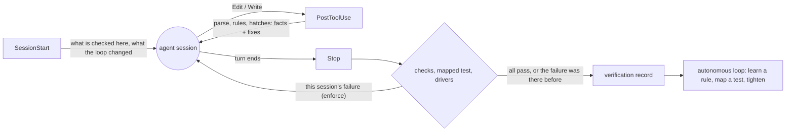

# Ratchet

[](https://github.com/kootru-repo/trust-ratchet/actions/workflows/ci.yml)
[](LICENSE)


**A trust harness for AI coding agents.** Ratchet runs programs around a coding agent: after every edit and before every turn ends. What the programs find goes back to the agent as facts, each with its fix. A correction you make once becomes a rule that is checked from then on, so the same mistake cannot come back quietly. Like a ratchet, it only tightens.

It works with [Claude Code](https://claude.com/claude-code) through its hooks. It has no runtime dependencies and uses no API key.

```
agent edits a file ──► programs check it ──► facts go back to the agent
agent ends its turn ─► checks, the mapped test, drivers ─► a failure the session caused holds the turn
you correct the agent ─► `ratchet rule add` ─► proven on the fix commit ─► checked on every edit from now on
```

## Contents

- [Why](#why)
- [What it does](#what-it-does)
- [Quick start](#quick-start)
- [How it works](#how-it-works)
- [Use cases](#use-cases)
- [Commands](#commands)
- [Configuration](#configuration)
- [Code review](#code-review)
- [Experimental parts](#experimental-parts)
- [What it writes and how to remove it](#what-it-writes-and-how-to-remove-it)
- [FAQ](#faq)
- [Contributing](#contributing)

## Why

A coding agent says "done, tests pass" whether or not that is true. Asking it to be more careful adds another line of prose it may not follow. Ratchet takes the other route:

1. **A program decides before a model does.** Parse checks, rules, type checks and tests run first. Their results are facts.
2. **Every correction becomes a check.** A fix you had to ask for turns into a rule or a test, not another instruction.
3. **Nothing loosens by itself.** Backlogs may fall and never rise. The harness's own loop may add or tighten; every change is logged with its undo.
4. **The author is never the reviewer.** Review is done by sessions that never saw the work, and a finding stands only with quoted code a program has matched against the tree.

## What it does

| | |
|---|---|
| **After each edit** | Checks that the file parses, that it breaks none of the project's rules, and that no escape hatch was added (`as unknown as`, `@ts-ignore` and the like). |
| **Before the turn ends** | Runs the same checks on every file the session changed, then the project's own commands: checks, the one test mapped to those files, and drivers that run the real thing. Writes a verification record. |
| **Advise or enforce** | In `advise` mode it reports. In `enforce` mode a failure the session caused holds the turn, at most twice. A failure that was already there never holds it. |
| **Rules from corrections** | `ratchet rule add` bans a pattern, an import or an API in the files you name. A rule can be proven on the commit that fixed the fault. A census of the same fault elsewhere is kept as a backlog that may only fall. |
| **Escape-hatch ceiling** | Counts the hatches in the repository and refuses a rise. |
| **Autonomous loop (optional)** | After each checked turn it can write a trial rule from a fix commit, map a new test once it has passed alone, lower backlogs, and promote or retire its own rules. It only tightens and tells the next session what it did. |
| **Code review** | `ratchet review` and `review-work`: specialists look for candidates, a program checks every quotation, verifiers decide with cited code, and a confirmed finding can be reproduced as a failing test. |
| **Measurement** | `measure`, `level`, `lessons`, `dashboard` and `backtest` report what the harness changed, from git history and its own records. |

## Quick start

**Needs:** Node 22.6 or later, git, and the `claude` command, logged in. Reproduction of findings also needs `tar`.

```bash
git clone https://github.com/kootru-repo/trust-ratchet.git
cd trust-ratchet
npm install          # dev dependencies only: TypeScript and Node types
npm test

# install the hooks (see "What it writes" below; your settings file is backed up first)
npm run ratchet -- install

# switch it on for one project, in advise mode
npm run ratchet -- on --project /path/to/your/project
npm run ratchet -- init --project /path/to/your/project     # writes a config from what it finds
npm run ratchet -- status --project /path/to/your/project
```

Then start Claude Code in that project. Ratchet tells the session what it checks, and the session sees the results after each edit. In Claude Code, `/ratchet status` runs the same command.

When you trust what it reports, hold the turn on failures:

```bash
npm run ratchet -- on --project /path/to/your/project --mode enforce
```

After `install`, the installed copy can be called from anywhere:

```bash
node --experimental-strip-types --no-warnings ~/.claude/ratchet/app/ratchet.ts status
# Windows also gets a launcher:  %USERPROFILE%\.claude\ratchet\ratchet.cmd status
```

> The hooks run the installed copy, never the clone, so editing Ratchet's source cannot break a running session. Run `install` again after you pull or change the source.

## How it works



Five hook entries are installed: `SessionStart`, `PreToolUse` and `PostToolUse` on file edits, `Stop`, and `UserPromptSubmit`. Each starts the same small program, which leaves at once when the switch is off for the project.

**The three layers of a turn-end check**

1. **Always**: the file parses, the rules hold, no new escape hatch.
2. **Checks**: commands from the project's config (type check, lint). A command runs again only when its own files changed.
3. **Tests and drivers**: the one test mapped to the changed files (never the whole suite; three mapped tests a turn at most by default) and commands that run the real thing.

**Whose failure is it?** Ratchet compares against the state before the session's changes. A failure that was there before is reported and never holds the turn.

**Where state lives.** Rules, config and records are kept under `~/.claude/ratchet/projects/<project>/`, outside your repository, unless the repository has a `.ratchet/` folder (`init --in-repo`), which then wins and can be committed and shared.

## Use cases

**Stop a repeated mistake.** The agent keeps calling `subprocess.run` without an encoding. Fix it once, then:

```bash
ratchet rule add --id subprocess-text-needs-encoding --kind ban-pattern \
  --pattern "subprocess\.run\((?![^)]*encoding=)[^)]*text=True" --scope statement \
  --files "tools/**/*.py" \
  --message "subprocess.run(text=True) without encoding= breaks on non-ASCII output" \
  --fix "add encoding='utf-8'" \
  --proof-commit <the fix commit> --proof-file tools/build.py
ratchet census          # how many of the same fault are still in the repository
```

**Keep a layer clean.** Ban an import in a folder: `--kind ban-import --pattern torch --files "core/**/*.py"`.

**Make "tests pass" true.** Map each test to the file it sits beside, so the right test runs before a turn ends:

```bash
ratchet init --pair-tests --py-test "python -B {test}" --ts-test "node --test {test}"
```

**Review the work before you commit it**, by reviewers that never saw the session:

```bash
ratchet review-work --project . --since HEAD --out report.md
```

**Review a commit or one file**, with deterministic checks first:

```bash
ratchet review-commit . HEAD --check "npm run check-types"
ratchet review . src/parse.ts --check "npm run check-types" --out report.md
```

**See what nothing watches.** `ratchet features` writes a map of every source folder and what checks it; unwatched folders are listed.

**Let it tighten by itself.** `ratchet auto --on` runs the loop after each checked turn. `ratchet level` prints the verification level with every requirement met or not, and `ratchet dashboard` writes one page for all projects.

**Ask whether it helps.** `ratchet measure` reads fixes, fixes of a fix and reverts from git history, split at the date the switch went on.

## Commands

`ratchet` below means `npm run ratchet --` in the clone, or the installed copy. Every command takes `--project <dir>` (default: the current folder). The full list with every flag is in [docs/COMMANDS.md](docs/COMMANDS.md); `ratchet help` prints it.

| Command | What it does |
|---|---|
| `install` / `uninstall` | Add or remove the five hook entries and the installed copy's slash command. |
| `on` / `off` `[--project <dir>] [--mode advise\|enforce]` | The global switch, or one project's own switch. |
| `default --project <dir>` | Drop a project's own switch so it follows the global one. |
| `status` | Whether it is on here, the mode, and what is checked. |
| `init` `[--in-repo] [--force] [--keep-own] [--pair-tests]` | Write a project config from what is found. |
| `rule add` / `rule list` / `rule remove` | Manage rules: `ban-pattern`, `ban-import`, `ban-api`. |
| `census [--tighten]` | Each rule's count now against its baseline. |
| `hatches [--set-ceiling]` | Escape hatches against the stored ceiling. |
| `comments --mode off\|excuses\|ban` | The no-comments constraint. |
| `must-not add` / `from-vault` / `list` | Cases a reviewer must not flag again. |
| `features` | The feature map: what watches each folder. |
| `baseline [--minutes 10]` | Run the mapped commands once on the tree as it is. |
| `auto [--on\|--off] [--guards] [--backlog]` | One pass of the autonomous loop, or switch it. |
| `limits`, `level`, `lessons`, `measure`, `dashboard`, `backtest`, `guides` | Reports and the loop's own limits. |
| `review`, `review-commit`, `review-work` | Code review (see below). |
| `bench`, `guard`, `retire`, `effort`, `vault` | The review benchmark, guards from reproduced findings, and the notes vault. |
| `launchgate`, `gates`, `decisions`, `drivers`, `tokens` | Small tools: a machine-load gate before starting workers, proof gates, a decision-log check, driver checks, token use of a session. |

## Configuration

`ratchet init` writes `config.json` for the project. All keys are optional.

```jsonc
{
  // run before the turn ends; {files} is replaced by the changed files that match `when`
  "checks":  [{ "name": "types", "command": "npm run check-types", "when": ["src/**/*.ts"] }],
  // the ONE relevant test for a set of files, never a whole suite
  "tests":   [{ "name": "parse", "command": "node --test test/parse.test.ts", "when": ["src/parse.ts"] }],
  // commands that run the real thing
  "drivers": [{ "name": "cli-help", "command": "node src/cli.ts help", "when": ["src/cli.ts"] }],
  "maxTestsPerStop": 3,
  "budgetS": { "stop": 120 },
  "hatchCeiling": 12,
  "comments": { "mode": "off" },
  "auto": false,
  "autoExclude": ["vendor/**"],
  "notOurs": ["third_party/**"],
  "noFullRuns": true
}
```

Every key, its default and its meaning: [docs/CONFIGURATION.md](docs/CONFIGURATION.md).

Environment variables: `RATCHET_HOME` moves everything Ratchet keeps (default `~/.claude/ratchet`); `RATCHET_SETTINGS` points at another Claude Code settings file. Both are useful for trying it without touching your real setup.

## Code review

`review`, `review-commit` and `review-work` keep finding candidate bugs apart from verifying them.

| Layer | What it does | Who decides |
|---|---|---|
| 0. Deterministic checks | Runs the commands you pass with `--check`. Results reach the reviewers as facts. | A program |
| 1. Plan | Picks specialists from the file's contents. | A program |
| 2. Specialists | One bug class each. Each returns concerns and dismissals; a dismissal is marked `local` (the cited code proves it) or `assumed`. | A model |
| 3. Citation check | Every concern and dismissal must quote text that is really at the cited line. A quote that does not match is dropped. | A program |
| 4. Triage | Proven dismissals are dropped, assumed ones become checks, neighbours are merged. | A program |
| 5. Verifiers | One per surviving candidate. Neither "bug" nor "fine" is accepted without code. | A model |
| 6. Proof check | A verdict stands only if every proof quote matches the tree. | A program |
| 6b. Reproduction (optional) | A test of the correct behaviour is written and run. A failed assertion reproduces the finding. | A program runs it |
| 7. Report | Confirmed findings, open questions, refuted claims, what was not verified, what was dropped and why. | A program |

Language packs hold everything that depends on the language (`src/pack.ts`):

| | TypeScript | Python |
|---|---|---|
| Specialists | intent, nullflow, async, types, react | intent, missing, mutation, shape, determinism, units, io |
| Always-on check | none | `python -m py_compile` |
| Reproduction | vitest, own config | pytest, JUnit report |

The report goes to a file or the terminal. Ratchet never posts anywhere. Model calls go through the `claude` command on your own login.

**Known limits.** Without `--repro`, "confirmed" means a verifier cited matching code and argued from it, nothing more. A specialist that dismisses a candidate and labels its own proof `local` is taken at its word. Reproduction only reaches code a unit test can call. At most `--max-checks` candidates are verified per file; the rest are listed as not verified. Review quality has not been established on a large benchmark: treat findings as leads to check.

## Experimental parts

These are in the tree, tested as units, and **not ready for general use**:

- `src/swarm/`: several workers in separate git worktrees with an independent verifier each, a guard for what a worker may touch, a launch gate on machine load, and a ladder that raises the number of workers one step at a time. It has run only at one and two workers.
- Property testing (`src/harness/props.ts`, `pageprops.ts`), the doctor, the cycle and merge-class modules: building blocks with tests, not yet wired into a turn.

Their interfaces will change.

## What it writes and how to remove it

`install` does exactly this:

- copies the harness to `~/.claude/ratchet/app` and proves the copy starts;
- adds five hook entries to `~/.claude/settings.json`, after a backup to `~/.claude/ratchet/backup/`, leaving every other entry and the file's formatting as they were;
- writes the slash command `~/.claude/commands/ratchet.md` and, on Windows, `~/.claude/ratchet/ratchet.cmd`.

It installs no git hook, commits nothing, and sends nothing anywhere. `uninstall` removes exactly the five entries and the slash command; rules and records stay until you delete `~/.claude/ratchet`.

## FAQ

**Does it slow the agent down?** The edit hook is a parse and a few pattern checks. The turn-end check has a time budget and runs a command only when its own files changed.

**Will it block me on failures I did not cause?** No. Only a failure this session introduced can hold a turn, only in `enforce` mode, and at most twice.

**Does it need an API key?** No. Review commands call the `claude` command you are already logged in to; the hooks call no model at all.

**Which languages?** The hooks check any text file against rules and parse TypeScript, JavaScript, Python and JSON. Review has packs for TypeScript and Python.

**Which platforms?** It is developed on Windows and tested in CI on Windows and Linux.

**Can a team share rules?** Yes: `init --in-repo` and `rule add --in-repo` keep them in `.ratchet/` in the repository.

## Background

Ratchet applies ideas from two public sources and shares no code or prompts with either:

- Sashiko, the Linux kernel review system (Gushchin and Brewer, "Sashiko: Lessons from building an agentic code review system for Linux", Google Cloud blog, 2026): one focus per reviewer, every reviewer records what it ruled out, shaky dismissals get a second look, one verifier per hard case.
- Lauren Tan's talk "All code is slop": deterministic checks come before anything a model says, and every correction should become a lint rule or a test, not another line of prose.

## Contributing

Issues and pull requests are welcome. Start with [CONTRIBUTING.md](CONTRIBUTING.md); security reports go through [SECURITY.md](SECURITY.md). Everyone taking part is expected to follow the [Code of Conduct](CODE_OF_CONDUCT.md).

## License

[MIT](LICENSE)
